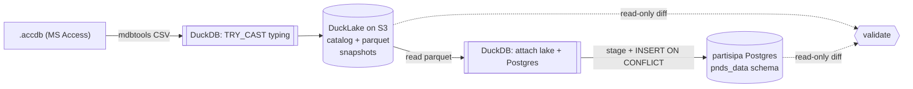

# Architecture

`mdb-ducklake` has two halves that share nothing but the mirror:

1. **Mirror** — read an `.accdb` and maintain a typed, incremental DuckLake
   lakehouse on S3.
2. **Postgres sync** (partisipa, "Option B") — push that mirror set-based into a
   Postgres schema, with read-only reconciliation and a guarded delete.



One DuckDB engine spans all of it; `mdbtools` is the only non-DuckDB piece
(extraction). Dependencies are just `duckdb`, `pytz`, `boto3`, `psycopg2`.

## Half 1 — the mirror

### Storage model
Catalog and data live in the **same S3 bucket**; git stays code-only.

- **Catalog** (metadata) — a DuckDB file, e.g.
  `s3://ducklake/pnds/catalog.ducklake`. Source of truth for which
  snapshots/tables exist. A DuckLake catalog can't be attached read-write over
  S3, so the CLI **downloads it before a run and uploads it after** (`boto3`,
  single-writer). Cold readers pull it too — a fresh process with nothing local
  reconstructs the whole mirror from S3 alone.
- **Data** (Parquet) — under `DATA_PATH`, e.g. `s3://ducklake/pnds/data`.

Local paths work for either (a `.ducklake` file and a `data/` dir); nothing then
touches S3. Code: `src/mdb_ducklake/sync.py` (`open_lake`, `Lake.push_catalog`)
and `src/mdb_ducklake/s3store.py`.

### Typing (lossless)
Types come from the Access schema (`mdb-schema`), not the CSV sniffer:

| Access | DuckDB |
|---|---|
| Long Integer / Integer / Byte | BIGINT / INTEGER / UTINYINT |
| Single / Double | FLOAT / DOUBLE |
| Currency / Decimal | DECIMAL(19,4) |
| DateTime | TIMESTAMP |
| Boolean | BOOLEAN |
| Text / Memo | VARCHAR |

Each table is loaded as raw text, then `TRY_CAST` into the typed schema:

- every row is kept (a bad value → NULL, never a dropped row);
- a *successful* cast is reversible, so the only lost information is a cell that
  fails to cast — preserved verbatim in the hidden **`_mdb_cast_rejects`** table
  `(table_name, row_ordinal, column_name, access_type, raw_value)`, counted in
  the sync report.

On PNDS: exactly 10 rejects, all the invalid `1900-01-00` zero date.

### Incremental
Each table is exported and sha256-fingerprinted; a table whose fingerprint
matches the last sync is skipped (no load, no Parquet, no upload). Fingerprints
are kept in the hidden **`_mdb_sync_state`** table. `--full-refresh` forces a
reload (needed once after a loader change, since unchanged sources are skipped).

### Completeness caveats
`mdb-count` is an unreliable oracle on ACE12 files — it disagrees with the
actual exported rows in both directions — so the per-table count check prints a
**REVIEW** list, not pass/fail. Two known mdbtools gaps on PNDS, accepted:
`syncImportLog` (mdbtools reads 0 rows) and `zFreebalance_Budget_extract`
(genuinely empty). Extraction fidelity was verified by cross-checking a second
independent reader.

## Half 2 — the Postgres sync

Three console commands, all driven by a **mapping artifact** generated by
partisipa's `manage.py dump_ducklake_mapping` (authoritative Access→Postgres
column/type map, PK, FK graph — because the mapping is irregular and lives in
partisipa's Django models, not derivable by lowercasing).

| Command | Role | Safety |
|---|---|---|
| `mdb-ducklake-validate` | read-only reconcile: row counts, PK-set diffs, `--deep` changed rows | writes nothing |
| `mdb-ducklake-to-postgres` | set-based upsert (stage + `ON CONFLICT`, change-filtered) | never deletes |
| `mdb-ducklake-prune` | delete rows gone from the mirror | dry-run default; guarded |

All three take `--json` for a structured run report (for logging/alerting);
exit codes signal drift/mismatch.

### Upsert mechanics (`to_postgres.py`)
1. DuckDB attaches both the lake (S3) and Postgres, and creates a staging schema
   in PG.
2. Per table, `mapped_projection` builds the mirror→Postgres column projection —
   Access col → PG col, `TRY_CAST` to the PG target type, naive `TIMESTAMP` →
   UTC. Fractional (Currency/Double) sources landing in an **integer** column are
   **truncated** toward zero, matching the ORM importer's `int()` (DuckDB's cast
   would round — an off-by-one on financial cells; see the parity note).
3. DuckDB streams each table's Parquet into a PG staging table.
4. One transaction runs every `INSERT … ON CONFLICT (pk) DO UPDATE`, FK checks
   deferred to commit so tables can be upserted in any order. The `DO UPDATE` is
   change-filtered (`target IS DISTINCT FROM EXCLUDED`) so unchanged rows aren't
   rewritten.

`validate` reuses `mapped_projection`, so a clean validate genuinely means a
sync would no-op — no false positives from type/tz handling.

### Materialized views
`pnds_data` has dbsamizdat-managed matviews; 11 of 13 read tables we sync, and 2
carry per-write auto-refresh triggers whose `REFRESH MATERIALIZED VIEW
CONCURRENTLY` can't run inside our bulk transaction. **The sync tool is
trigger-agnostic**; partisipa brackets the run:

```
manage.py dbsamizdat nuke     # drop managed matviews + triggers
mdb-ducklake-to-postgres …    # bulk upsert — nothing to conflict
mdb-ducklake-prune --apply …  # optional
manage.py dbsamizdat sync     # recreate + refresh in dependency order
```

Run off-peak: matviews don't exist between `nuke` and `sync`.

### Parity with the old ORM importer
Loading the same `.accdb` through the ORM importer and through this pipeline and
diffing (`validate --deep`) showed **identical row counts** and only the 8
intentional `1900-01-00`→NULL cells differing — after the currency-truncation
fix above. See `docs/postgres-sync-handoff.md` for the run sequence and the
pre-production checklist.

## Module map

| File | Responsibility |
|---|---|
| `sync.py` | DuckLake open/attach, mirror load (`load_full`), typing, incremental, snapshots |
| `access.py` | stdlib mdbtools CLI wrapper (list/export/schema) |
| `s3store.py` | boto3 catalog download/upload |
| `to_postgres.py` | mapping, `mapped_projection`, staging + upsert, `load_order` |
| `validate_postgres.py` | read-only mirror↔Postgres reconcile |
| `prune_postgres.py` | guarded delete of rows gone from the mirror |
| `cli.py` | the `mdb-ducklake` mirror CLI (sync/sync-csv/info) |
